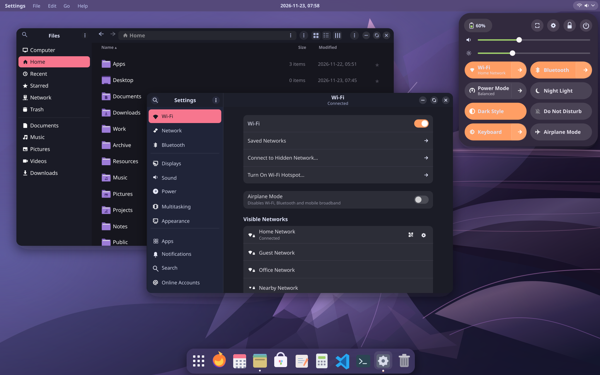

# TokyoAdwaita Night

[](assets/TokyoAdwaita-Night-preview.svg)

A dark GNOME theme for **Fedora 45 / GNOME 51**. Uses TokyoNight Night backgrounds
and a single accent across GTK3, GTK4/libadwaita, GNOME Shell, and the native
Shell accent. Flatpak GTK theming is configured automatically when Flatpak is present.

## Install

Run as your **desktop user**, without `sudo`:

```sh
./install.sh           # TokyoNight blue (default)
./install.sh peach     # Choose a different accent
./configure.sh purple  # Change an installed accent
./uninstall.sh         # Remove and restore previous settings
```

The installer will ask for permission to install missing Fedora packages
(`gcc`, `binutils`, `gnome-shell-extension-user-theme`) through `sudo dnf`.
Log out and back in to activate Shell changes. Restart open GTK applications.

Supported colors (case-insensitive names or a six-digit `#RRGGBB` hex value):

| Name | Hex | Name | Hex |
| --- | --- | --- | --- |
| **blue (default)** | `#7aa2f7` | cyan | `#7dcfff` |
| purple | `#9d7cd8` | magenta | `#bb9af7` |
| green | `#9ece6a` | teal | `#1abc9c` |
| yellow | `#e0af68` | **peach** | `#ff9e64` |
| red | `#f7768e` | | |

No installation flags: the desktop theme, Flatpak integration (if installed),
and the **native accent hook** are installed together. The hook uses `LD_PRELOAD`
ELF symbol interposition in `org.gnome.Shell@user.service` to replace native
slate with the selected color. It **does not patch Fedora libraries**.
GNOME's setting still reads `slate`; its in-memory rendering is overridden.

## Existing older installations

This release intentionally has **no migration support**. Uninstall any previous
TokyoAdwaita release using its original `uninstall.sh`, and any standalone
GNOME Slate Detour v2 with its original uninstall script, **before** running
this installer. Otherwise, the installer refuses unknown state or an existing
Shell preload. It will not remove those installations automatically.

## Diagnostics and tests

```sh
./diagnose.sh
./validate.sh
make -C native-accent-hook test
```

The installer's state and file checks protect existing GTK CSS, theme files,
GNOME preferences, and Flatpak overrides. If a managed file is edited externally,
removal stops rather than deleting it. If an installed Flatpak override changes,
uninstallation leaves it alone.

**TTY recovery if Shell will not start:** Ctrl+Alt+F3, then remove only
`~/.config/systemd/user/org.gnome.Shell@user.service.d/80-tokyoadwaita-accent.conf`,
run `systemctl --user daemon-reload`, and reboot. Do not remove other service drop-ins.
The hook may require retesting after GNOME upgrades.

## License

Code and templates: [MIT](LICENSE). TokyoNight palette attribution:
[TokyoNight](https://github.com/folke/tokyonight.nvim), Apache 2.0
([license](licenses/TOKYONIGHT-APACHE-2.0.txt)). The Shell stylesheet is generated
from Fedora's installed GNOME resources, not bundled.
